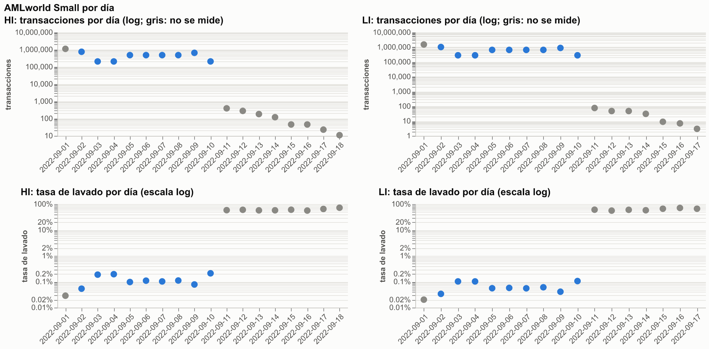
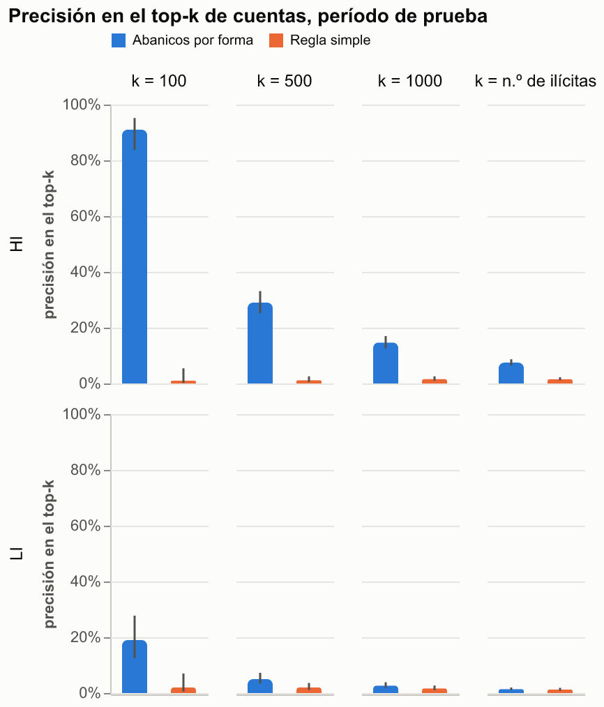
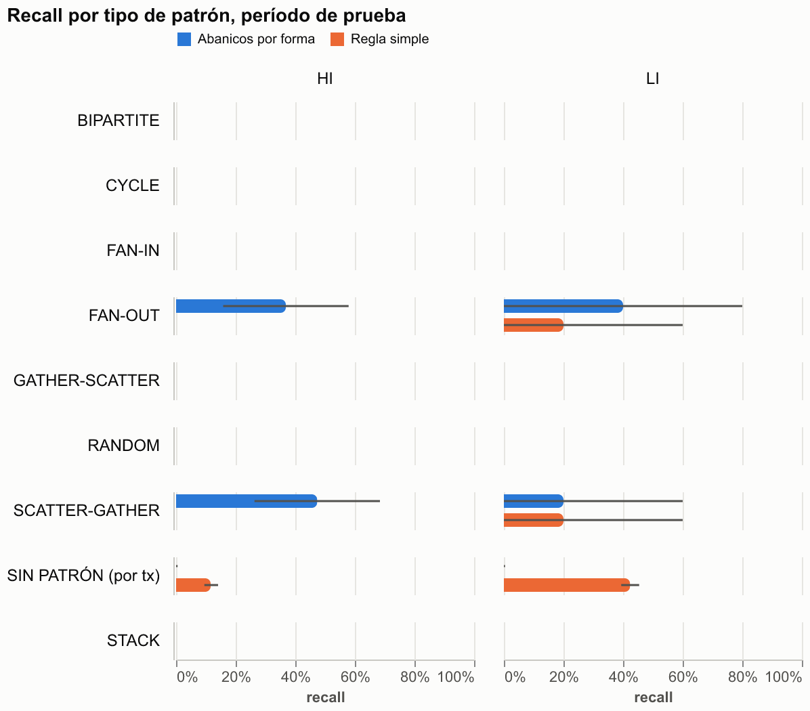
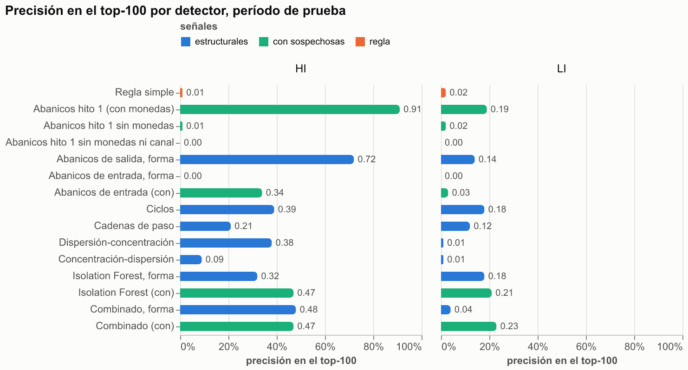
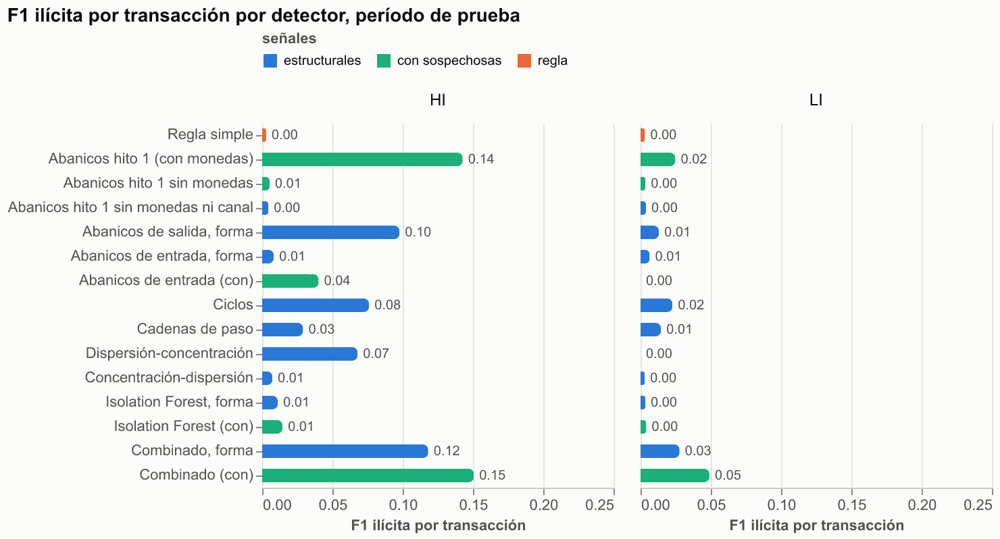
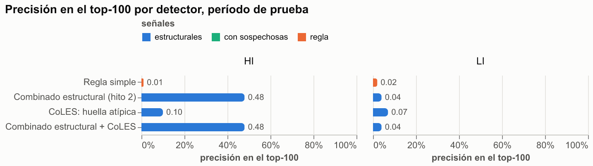

# Informe técnico

Detección de lavado de activos en redes de transferencias con AMLworld (caso 2 del
portafolio de banca). Cada hito deja aquí todas sus cifras, supuestos y limitaciones.

**Cifra principal del proyecto: el combinado estructural** del hito 2, que solo usa tiempo,
montos y topología. En el período de prueba: F1 ilícita por transacción 0,118 en HI y 0,028 en
LI; precisión en el top-100 de 0,48 y 0,04 (regla simple: F1 0,003 y top-100 de 0,01 y 0,02).
Las versiones que usan moneda o formato de pago (hasta F1 0,151 en HI) dependen de una huella
del simulador (ver la ablación del hito 2) y se muestran solo como referencia.
El hito 3 (CoLES) no mejoró esa cifra: la huella de comportamiento contiene información sobre
el lavado, pero sin etiquetas no se aprovecha.

## Hito 1: ingesta, exploración y abanicos por forma

### Datos

AMLworld (IBM) es un generador sintético de transferencias con lavado sembrado. Se usan las
variantes **Small**: HI (más lavado) y LI (menos lavado).

| | HI-Small | LI-Small |
|---|---|---|
| Transacciones | 5.078.345 | 6.924.049 |
| Cuentas | 518.581 | 712.688 |
| Transacciones de lavado | 5.177 (1 de cada 981) | 3.565 (1 de cada 1.942) |
| Intentos documentados (`_Patterns.txt`) | 370 | 117 |
| Lavado cubierto por intentos | 3.209 tx (62 %) | 1.023 tx (29 %) |

- Las 4.232 líneas de patrones cruzan con una transacción de lavado; ninguna queda sin cruce.
- Cuenta = banco (entero) + número; todas las cuentas de las transacciones están en el
  archivo de cuentas. El CSV repite la columna `Account` y se lee con nombres explícitos.
- 15 monedas. Los montos se pasan a USD con tasas implícitas estimadas por mínimos
  cuadrados sobre las transferencias entre monedas distintas de los días 1 a 6 (por ejemplo,
  euro 1,172, yuan 0,150, bitcoin 11.794 USD en HI).
- Historias por cuenta (sin autotransferencias, días 1 a 10): mediana de 10 transferencias,
  50 % de las cuentas activas con 10 o más, 38 % con 20 o más y 11 % con 50 o más (casi
  idéntico en HI y LI). Es el punto de partida para decidir en el hito 3 si alcanza para CoLES.



### Dos artefactos del generador

**Día 1 (arranque).** Concentra el 22 % de las transacciones (1,11 millones en HI, contra
440 mil de media en los días 2 a 10), el 46 % son autotransferencias `Reinvestment` (2,1 % el
resto de los días) y la tasa de lavado es 0,029 %, casi cuatro veces menor que la de los días
2 a 10 (0,106 %). En LI ocurre lo mismo: 22 %, 46 % y 0,020 % contra 0,058 %. Es el
arranque del simulador: **solo se usa como historia para calcular variables y no se miden
métricas sobre él.**

**Cola (11 al 18 de septiembre).** 1.108 transacciones en HI, de las que 655 (59 %) son de
lavado; en LI, 223 y 134 (60 %). Son intentos que siguen corriendo cuando el resto del mundo
ya se detuvo (109 intentos de HI tocan la cola; 7 viven solo en ella). Incluirla inflaría el
recall con transacciones casi siempre ilícitas: **se excluye de todo.**

### Partición temporal

| Período | Días | Uso |
|---|---|---|
| arranque | 1 | solo historia |
| desarrollo | 2 a 6 | toda decisión que mire etiquetas |
| prueba | 7 a 10 | una sola medición, con parámetros congelados |
| cola | 11 a 18 | excluida |

**Regla del corte.** Se fijó días 2–6 / 7–10, con la regla de mover el corte un día si algún
tipo de patrón quedaba con menos de 10 intentos en prueba. La decisión miró solo conteos de
etiquetas, antes de cualquier resultado de detector. Intentos por tipo (desarrollo incluye a
los que vienen del arranque; prueba, a los que siguen en la cola):

| Tipo | HI desarrollo | HI puente | HI prueba | LI desarrollo | LI puente | LI prueba |
|---|---|---|---|---|---|---|
| BIPARTITE | 25 | 2 | 18 | 6 | 2 | 8 |
| CYCLE | 20 | 15 | 18 | 1 | 4 | 7 |
| FAN-IN | 10 | 12 | 17 | 6 | 3 | 3 |
| FAN-OUT | 19 | 10 | 19 | 8 | 6 | 5 |
| GATHER-SCATTER | 10 | 20 | 20 | 3 | 4 | 4 |
| RANDOM | 14 | 10 | 17 | 7 | 2 | 6 |
| SCATTER-GATHER | 12 | 13 | 19 | 4 | 4 | 5 |
| STACK | 11 | 14 | 15 | 8 | 6 | 3 |

En HI todos los tipos tienen al menos 15 intentos en prueba: el corte se queda. **En LI
ningún corte puede cumplir la regla** (hay entre 12 y 19 intentos por tipo en todo el
archivo); la regla se aplica a HI y en LI el recall por tipo se reporta con su n y con
intervalos amplios.

**Intentos puente.** 96 intentos de HI y 31 de LI tienen transferencias en desarrollo y en
prueba. Sus transferencias se **ignoran en las métricas de ambos períodos** (no son positivas
ni negativas): 531 + 570 transacciones de lavado en HI y 185 + 225 en LI. También se ignoran
las cuentas cuyo único lavado del período está en intentos puente (621 en HI y 269 en LI en
prueba).

**Historia sin fuga.** Un detector trabajando en desarrollo ve solo transferencias anteriores
al 7 de septiembre. En prueba ve todo hasta el 10, incluido desarrollo como historia, pero
nunca etiquetas. La alerta se emite al cerrar la ventana.

### Grafo temporal dirigido

Multigrafo dirigido: cuentas como nodos y una arista por transferencia entre cuentas distintas,
con fecha, monto en USD, moneda y formato (4.486.418 aristas en HI). Vive como tabla en DuckDB;
`grafo.aristas_entre` arma subgrafos de igraph bajo demanda. Las autotransferencias se
conservan pero no son aristas.

Las consultas para el futuro agente (`consultas.py`: transacciones de una cuenta, vecinos a
k saltos, flujo por intervalos y estructuras detectadas) no leen etiquetas y aceptan `hasta`.

### Detector de abanicos por forma

Una **estructura** es una cuenta centro con todas las transferencias que envía (abanico de
salida) o recibe (abanico de entrada) en una ventana fija de W horas. Hay dos desfases (0 y
W/2), así que toda ráfaga de hasta W/2 horas cae completa en alguna ventana. Son candidatas
las que tienen al menos 3 contrapartes distintas. Opcionalmente, la estructura es de un solo
canal (formato de pago).

Variables de forma, en [0, 1]: `novedad` (contrapartes sin contacto previo), `exclusividad`
(qué parte de la actividad de cada contraparte es con el centro), `unicidad` (contrapartes /
transferencias), `homogeneidad` de montos, `formato` (participación del más frecuente),
`mezcla_monedas` (1 − participación de la moneda más frecuente) y `dispersion` (duración /
W). Puntaje = tamaño (log2 de contrapartes, o 1) × producto de las variables elegidas, con
piso 0,01.

**Regla simple** (comparación obligatoria): número de contrapartes distintas en 24 horas,
sin forma. Es el mismo código sin variables.

**Qué se aprendió en desarrollo, y se corrigió.** La primera versión suponía abanicos de una
sola moneda y concentrados en el tiempo, y con todas las variables daba un F1 de 0,015 en HI
desarrollo. Al comparar las estructuras de los 18 intentos FAN-IN y FAN-OUT de desarrollo
con 3 o más transferencias contra el resto (mediana; solo etiquetas de desarrollo):

| | abanicos de lavado | todas las estructuras |
|---|---|---|
| contrapartes | 8,5 | 3 |
| transferencias | 8,5 | 6 |
| participación de la moneda más frecuente | 0,76 | 1,00 |
| concentración temporal (1 − duración/W, W = 72 h) | 0,17 | 0,39 |

Los abanicos de lavado tienen **una transferencia por contraparte, mezclan monedas y se
reparten en el tiempo**: lo contrario de dos supuestos a priori. Se agregaron `unicidad`,
`mezcla_monedas` y `dispersion`, y se quitaron las dos variables orientadas al revés. Además,
muchos intentos son diminutos: en HI (los tres períodos) hay 16 FAN-OUT y 9 FAN-IN con grado
declarado 1 o 2, que no tienen forma de abanico.

**Selección.** Rejilla de 1.024 configuraciones: W en {24, 48, 72, 96} h, con o sin canal,
hasta 3 variables y tamaño log2 o ninguno. Criterio: máximo F1 ilícita por transacción en HI
desarrollo; empates a 3 decimales, gana la más simple. Resultado, congelado en el tag
`hito1-congelado`:

- **W = 96 h, por canal, puntaje = log2(contrapartes) × unicidad × mezcla_monedas.**
- Umbral de F1 elegido en el desarrollo de cada variante: 0,802 en HI y en LI (coinciden;
  el puntaje toma valores discretos). Regla simple: 7.280 contrapartes en HI (el máximo F1
  de la regla está en un solo centro gigante) y 11 en LI.

Cifras de desarrollo (**optimistas**, se usaron para elegir):

| | F1 tx | Precisión en top-100 |
|---|---|---|
| HI, abanicos por forma | 0,147 | 0,94 |
| HI, regla simple | 0,003 | 0,02 |
| LI, abanicos por forma | 0,073 | 0,60 |
| LI, regla simple | 0,003 | 0,01 |

### Resultados en prueba (días 7 a 10, medidos una sola vez)

Universo de prueba en HI: 1.789.315 transferencias (1.422 de lavado) y 366.967 cuentas (2.072
ilícitas). En LI: 2.440.396 transferencias (1.212 de lavado) y 501.213 cuentas (1.991
ilícitas). Intervalos de 95 %: Wilson para la precisión en el top-k, bootstrap de Poisson por
cuenta de origen para el F1 y bootstrap por intento para el recall.

**Precisión en el top-k de cuentas**

| | k = 100 | k = 500 | k = 1.000 | k = n.º de ilícitas |
|---|---|---|---|---|
| HI, abanicos por forma | **0,91** (0,84–0,95) | **0,29** (0,25–0,33) | **0,15** (0,13–0,17) | **0,075** (k = 2.072) |
| HI, regla simple | 0,01 (0,00–0,05) | 0,01 | 0,02 | 0,016 |
| LI, abanicos por forma | **0,19** (0,13–0,28) | **0,05** (0,03–0,07) | 0,03 | 0,014 (k = 1.991) |
| LI, regla simple | 0,02 (0,01–0,07) | 0,02 | 0,02 | 0,013 |

**F1 de la clase ilícita**

| | F1 tx (IC 95 %) | precisión tx | recall tx | marcadas | F1 cuenta |
|---|---|---|---|---|---|
| HI, abanicos por forma | **0,143** (0,083–0,209) | 0,344 | 0,090 | 372 | 0,118 |
| HI, regla simple | 0,003 (0,000–0,003) | 0,001 | 0,061 | 59.864 | 0,023 |
| LI, abanicos por forma | **0,025** (0,000–0,066) | 0,059 | 0,016 | 321 | 0,021 |
| LI, regla simple | 0,003 (0,003–0,004) | 0,002 | 0,372 | 290.811 | 0,018 |

En LI, el umbral de HI trasladado sin tocar da lo mismo para el detector (los umbrales
coinciden) y F1 0,003 para la regla.



**Recall por tipo de patrón** (intento detectado si al menos la mitad de sus transferencias
del período quedan marcadas; entre paréntesis, intentos con 3 o más transferencias en el
período, los únicos que pueden tener forma de abanico):

| Tipo | HI forma | HI regla | LI forma | LI regla |
|---|---|---|---|---|
| FAN-OUT | **7/19 = 0,37** (7/8) | 0/19 | 2/5 (2/4) | 1/5 |
| SCATTER-GATHER | **9/19 = 0,47** (8/11) | 0/19 | 1/5 (1/2) | 1/5 |
| FAN-IN | 0/17 (0/8) | 0/17 | 0/3 | 0/3 |
| GATHER-SCATTER | 0/20 | 0/20 | 0/4 | 0/4 |
| BIPARTITE, CYCLE, RANDOM, STACK | 0 | 0 | 0 | 0 |
| Sin patrón (por transacción) | 0/750 | 87/750 = 0,12 | 0/1.034 | 438/1.034 = 0,42 |



### Lectura

1. **La forma le gana al tamaño por mucho en HI, y la ganancia se sostiene en prueba.** El F1
   de prueba (0,143) es casi igual al de desarrollo (0,147) y 9 de las 10 primeras alertas son
   cuentas ilícitas, contra 1 de cada 100 con la regla. La regla, que solo cuenta
   contrapartes, llena el top con comercios y concentradores legítimos.
2. **Es un detector de abanicos de salida, y depende de las monedas** (ver la ablación del
   [hito 2](#1-ablación-de-la-mezcla-de-monedas)). Todo lo que encuentra se explica por estructuras
   de salida: FAN-OUT y la mitad dispersora de SCATTER-GATHER. FAN-IN y GATHER-SCATTER quedan
   en 0. La variable decisiva, `mezcla_monedas`, mira la moneda pagada, y en AMLworld el
   centro de un abanico de salida de lavado paga en varias monedas. Es una huella del
   generador más que una ley del lavado. Encontrar abanicos de entrada necesita otra señal y
   queda para el hito 2, junto con ciclos y dispersión-concentración.
3. **LI es mucho más difícil.** La precisión en el top-100 cae de 0,60 en desarrollo a 0,19 en
   prueba, con solo 5 intentos FAN-OUT y 5 SCATTER-GATHER en prueba. El 71 % del lavado de LI
   no pertenece a ningún intento documentado. Sigue por encima de la regla (0,19 contra 0,02
   en el top-100), pero el F1 es bajo y su intervalo toca 0.
4. **Nada de esto detecta el lavado sin patrón.** La regla "recupera" el 12 % (HI) y el 42 %
   (LI) de esas transacciones marcando 59.864 y 290.811 transferencias: no es detección, es
   volumen.

### Limitaciones

- Datos sintéticos de plantilla: la forma que funciona aquí (mezcla de monedas) puede no
  existir en datos reales. El caso propone validar después en TransXion y SAML-D.
- En LI, el recall por tipo se apoya en 3 a 8 intentos por tipo: los intervalos son muy
  anchos.
- Los parámetros se eligieron en HI con etiquetas de desarrollo. Eso es selección
  supervisada de hiperparámetros sobre un detector no supervisado, y así se declara.
- Las autotransferencias no son aristas ni entran en la evaluación. Hay 11 de lavado en HI
  (5 en desarrollo y 2 en prueba, estas dentro de intentos puente) y 3 en LI.
- El F1 por transacción marca todas las transferencias de una estructura que supera el
  umbral. Un centro de lavado con actividad legítima en el mismo canal y ventana aporta
  falsos positivos.

### Reproducir

```bash
uv sync
uv run python scripts/hito1.py preparar     # ~30 s
uv run python scripts/hito1.py explorar
uv run python scripts/hito1.py desarrollar  # ~10 min (1.024 configuraciones)
uv run python scripts/hito1.py evaluar      # ~5 min, usa los parámetros congelados
```

## Hito 2: ablación de monedas, detectores estructurales y combinación

### Advertencia sobre el período de prueba

**Los días 7 a 10 se evalúan en varios hitos.** El hito 1 ya los midió. El hito 2 los mide
una sola vez, al final y con parámetros congelados (tag `hito2-congelado`), pero ya no son
una prueba virgen. Lo que el hito 1 mostró en prueba (FAN-IN en 0, la caída en LI) motivó
parte de este hito, así que algunas decisiones están influidas por haber mirado prueba. Las
cifras de prueba del hito 2 son, por eso, algo optimistas respecto de una prueba nueva.

### Señales sospechosas de artefacto

AMLworld genera el lavado con plantillas. Dos señales que separan en este dataset
probablemente no existirían, o no igual, en un banco real:

- **Moneda.** El centro de un abanico de salida de lavado paga en varias monedas. En un banco
  de una sola moneda esta señal desaparece.
- **Formato de pago.** El 87 % del lavado de HI va por ACH (contra el 12 % del total).

Se consideran **estructurales** el tiempo, los montos (en USD) y la topología. Cada detector
se declara con o sin señales sospechosas, y una prueba verifica que ninguno declarado
estructural use moneda o formato (`tests/test_hito2.py`).

### 1. Ablación de la mezcla de monedas

Primero se quitó la mezcla de monedas del detector congelado del hito 1, sin tocar nada más
salvo el umbral (elegido en desarrollo). Después se quitó además el canal de pago. Por último
se volvió a elegir en desarrollo la mejor configuración de forma pura, sin moneda ni formato.

| | HI desarrollo F1 tx | HI desarrollo top-100 | HI prueba F1 tx | HI prueba top-100 | LI prueba F1 tx | LI prueba top-100 |
|---|---|---|---|---|---|---|
| Hito 1 congelado (unicidad × mezcla de monedas, por canal) | 0,147 | 0,94 | **0,143** | **0,91** | 0,025 | 0,19 |
| Sin mezcla de monedas (conserva el canal) | 0,005 | 0,00 | 0,005 | 0,01 | 0,004 | 0,02 |
| Sin mezcla de monedas ni canal | 0,007 | 0,00 | 0,004 | 0,00 | 0,004 | 0,00 |
| Abanicos de salida de forma pura, re-elegidos en desarrollo | 0,118 | 0,62 | **0,098** | **0,72** | 0,013 | 0,14 |

**El detector del hito 1, tal como quedó, depende casi por completo de las monedas.** Sin la
mezcla de monedas su F1 cae de 0,143 a 0,005 en prueba y su top-100 de 0,91 a 0,01. Aplicado
así, sería una huella del simulador que no se trasladaría a un banco con una sola moneda.

**La forma pura sí recupera buena parte, si se reconstruye el detector.** Mirar solo abanicos de
salida (las estructuras de entrada legítimas ahogaban la señal) y puntuar
novedad × unicidad × homogeneidad de montos en ventanas de 48 h da, en HI prueba, el 69 % del
F1 (0,098 contra 0,143) y el 79 % del top-100 (0,72 contra 0,91), sin moneda ni formato. En LI
queda el 52 % del F1 y el 74 % del top-100, sobre cifras ya bajas.

### 2. Diagnóstico en desarrollo: qué forma tiene el lavado

Sobre los intentos de HI desarrollo (solo etiquetas de desarrollo):

- **Ciclos:** encadenados en el tiempo, cerrados, de 2 a 10 saltos, de hasta unas 95 h, con
  montos casi constantes entre saltos (razón entre 0,88 y 1,19).
- **Dispersión-concentración, cadenas (RANDOM) y capas (STACK):** cada intermediaria reenvía
  casi el mismo monto que recibió (por ejemplo, 13.753,88 a 13.753,42), horas o días después.
- **FAN-IN:** una sola moneda en todos los intentos. La mezcla de monedas no puede encontrarlo.
- **Lavado sin patrón:** son transferencias sueltas, 978 pares distintos para 990 transacciones
  en HI. Casi ninguna de sus cuentas toca un intento documentado.

De ahí sale la pieza común del hito: el **par de paso**. Una cuenta recibe un monto y reenvía
uno parecido (±20 %) dentro de 96 h. Con esa tolerancia y esa ventana, el 100 % de las
transacciones de CYCLE y STACK, el 90 % de RANDOM y el 79 % de SCATTER-GATHER de desarrollo
están en algún par, contra el 20 % de las legítimas. Por sí solo el par de paso es un filtro
débil; la especificidad viene de encadenarlo.

### 3. Detectores

| Detector | Qué busca | Señales | Configuración congelada |
|---|---|---|---|
| Regla simple | contrapartes distintas en 24 h | tamaño | (sin parámetros) |
| Abanicos de salida, forma | centro que paga a muchas cuentas nuevas, una vez a cada una y con montos parecidos | estructurales | 48 h, novedad × unicidad × homogeneidad |
| Abanicos de entrada, forma | centro que recibe de muchas | estructurales | 96 h, log2(contrapartes) × dispersión |
| Abanicos de entrada (con) | ídem, con moneda y formato disponibles | sospechosas | 24 h, por canal, novedad × homogeneidad × dispersión |
| Ciclos | ciclo temporal que vuelve a la cuenta de origen con monto conservado en cada salto | estructurales | ±20 %, hasta 96 h por salto y en total, 2 a 10 saltos, puntaje saltos × consistencia |
| Cadenas de paso | cadena más larga de pares de paso que pasa por la transferencia | estructurales | ±20 %, 96 h |
| Dispersión-concentración | S reparte a k intermediarias distintas que reenvían a T | estructurales | ±20 %, 96 h, k ≥ 2 |
| Concentración-dispersión | junta de varias y reparte a varias en la misma ventana | estructurales | 96 h, log2(mínimo de los lados) × balance × unicidad |
| Isolation Forest, forma | cuentas raras por volumen, grado, unicidad, dinero de paso, velocidad, contrapartes nuevas y montos | estructurales | 200 árboles; transferencia = mínimo de sus dos cuentas |
| Isolation Forest (con) | ídem más número de monedas y participación de formatos | sospechosas | ídem |
| Combinado, forma | máximo de los percentiles de desarrollo de los 7 estructurales | estructurales | esquema `max` (elegido en desarrollo) |
| Combinado (con) | ídem con abanicos del hito 1, abanicos de entrada (con) e IF (con) | sospechosas | esquema `max` |

Cada configuración se eligió en HI desarrollo por máximo F1 ilícita por transacción, con
empates resueltos a favor de la más simple. Los umbrales de transacción y de cuenta se fijaron
en el desarrollo de cada variante. Para combinar, cada puntaje se pasa a su percentil en
desarrollo. Esa tabla se congela y en prueba se aplica sin mirar la distribución de prueba.

### 4. Resultados en prueba (días 7 a 10, medidos una sola vez en este hito)

**HI** (1.422 transacciones de lavado evaluables, 2.072 cuentas ilícitas):

| Detector | Señales | F1 tx (IC 95 %) | Top-100 (IC) | Top-500 | Top-1.000 | F1 cuenta |
|---|---|---|---|---|---|---|
| Regla simple | tamaño | 0,003 (0,000–0,003) | 0,01 (0,00–0,05) | 0,01 | 0,02 | 0,024 |
| Abanicos hito 1 | sospechosas | 0,143 (0,083–0,209) | **0,91** (0,84–0,95) | 0,29 | 0,15 | 0,118 |
| Abanicos de salida, forma | estructurales | 0,098 (0,041–0,159) | 0,72 (0,63–0,80) | 0,23 | 0,13 | 0,082 |
| Abanicos de entrada, forma | estructurales | 0,008 | 0,00 | 0,01 | 0,02 | 0,016 |
| Abanicos de entrada (con) | sospechosas | 0,040 | 0,34 | 0,13 | 0,10 | 0,037 |
| Ciclos | estructurales | 0,076 (0,046–0,112) | 0,39 (0,30–0,49) | 0,13 | 0,07 | 0,051 |
| Cadenas de paso | estructurales | 0,029 | 0,21 | 0,11 | 0,07 | 0,042 |
| Dispersión-concentración | estructurales | 0,068 (0,036–0,106) | 0,38 (0,29–0,48) | 0,12 | 0,06 | 0,053 |
| Concentración-dispersión | estructurales | 0,007 | 0,09 | 0,04 | 0,05 | 0,032 |
| Isolation Forest, forma | estructurales | 0,011 | 0,32 (0,24–0,42) | 0,12 | 0,09 | 0,054 |
| Isolation Forest (con) | sospechosas | 0,015 | 0,47 | 0,18 | 0,11 | 0,071 |
| **Combinado, forma** | estructurales | **0,118** (0,079–0,159) | 0,48 (0,38–0,58) | 0,29 | 0,18 | 0,122 |
| **Combinado (con)** | sospechosas | **0,151** (0,108–0,203) | 0,47 (0,38–0,57) | **0,31** | **0,22** | **0,142** |

**LI** (1.212 transacciones de lavado evaluables, 1.991 cuentas ilícitas):

| Detector | Señales | F1 tx (IC 95 %) | Top-100 (IC) | Top-500 | Top-1.000 | F1 cuenta |
|---|---|---|---|---|---|---|
| Regla simple | tamaño | 0,003 (0,003–0,004) | 0,02 (0,01–0,07) | 0,02 | 0,02 | 0,021 |
| Abanicos hito 1 | sospechosas | 0,025 (0,000–0,066) | 0,19 (0,13–0,28) | 0,05 | 0,03 | 0,021 |
| Abanicos de salida, forma | estructurales | 0,013 | 0,14 | 0,04 | 0,02 | 0,013 |
| Abanicos de entrada, forma | estructurales | 0,007 | 0,00 | 0,02 | 0,01 | 0,015 |
| Abanicos de entrada (con) | sospechosas | 0,000 | 0,03 | 0,02 | 0,03 | 0,003 |
| Ciclos | estructurales | 0,023 (0,013–0,037) | 0,18 (0,12–0,27) | 0,09 | 0,06 | 0,038 |
| Cadenas de paso | estructurales | 0,015 | 0,12 | 0,05 | 0,04 | 0,024 |
| Dispersión-concentración | estructurales | 0,000 | 0,01 | 0,04 | 0,03 | 0,013 |
| Concentración-dispersión | estructurales | 0,003 | 0,01 | 0,02 | 0,02 | 0,016 |
| Isolation Forest, forma | estructurales | 0,003 | 0,18 | 0,06 | 0,04 | 0,027 |
| Isolation Forest (con) | sospechosas | 0,004 | 0,21 | 0,06 | 0,04 | 0,029 |
| Combinado, forma | estructurales | 0,028 (0,016–0,043) | 0,04 (0,02–0,10) | 0,07 | 0,06 | 0,036 |
| **Combinado (con)** | sospechosas | **0,049** (0,021–0,097) | **0,23** (0,16–0,32) | **0,13** | **0,08** | **0,055** |





**Recall por tipo en HI prueba** (intentos detectados / intentos; un intento cuenta si al menos
la mitad de sus transferencias quedan marcadas):

| Tipo | Regla | Abanicos h1 | Salida forma | Ciclos | Disp.-conc. | Combinado forma | Combinado (con) |
|---|---|---|---|---|---|---|---|
| FAN-OUT | 0/19 | 7/19 | 4/19 | 5/19 | 0/19 | 3/19 | 4/19 |
| FAN-IN | 0/17 | 0/17 | 0/17 | 3/17 | 0/17 | 2/17 | 3/17 |
| CYCLE | 0/18 | 0/18 | 0/18 | 7/18 | 0/18 | 6/18 | 6/18 |
| SCATTER-GATHER | 0/19 | 9/19 | 7/19 | 6/19 | 3/19 | 9/19 | 8/19 |
| GATHER-SCATTER | 0/20 | 0/20 | 0/20 | 2/20 | 0/20 | 3/20 | 5/20 |
| RANDOM | 0/17 | 0/17 | 0/17 | 6/17 | 0/17 | 2/17 | 2/17 |
| STACK | 0/15 | 0/15 | 0/15 | 3/15 | 0/15 | 2/15 | 2/15 |
| BIPARTITE | 0/18 | 0/18 | 0/18 | 4/18 | 0/18 | 2/18 | 2/18 |
| Sin patrón (tx) | 87/750 | 0/750 | 0/750 | 7/750 | 0/750 | 1/750 | 1/750 |

**El fin de la ventana trunca estructuras.** Es un diagnóstico posterior sobre el mismo
resultado congelado, sin medir de nuevo. En HI, 11 de los 18 ciclos de prueba y 16 de las 19
dispersiones-concentraciones siguen en la cola, después del día 10, y no pueden cerrarse
dentro de la ventana. El detector de ciclos encuentra **los 7 ciclos de HI que se cierran
dentro de la ventana** (y 2 de 2 en LI) y ninguno de los truncados. En desarrollo esto no pasa,
porque el día 1 queda como historia. La caída de dispersión-concentración (7/12 en desarrollo,
3/19 en prueba) no se explica así: no detecta ninguna de las 3 completas.

### 5. Diagnóstico de LI (en desarrollo)

| | HI desarrollo | LI desarrollo |
|---|---|---|
| Lavado evaluable (tx) | 1.672 | 1.496 |
| Sin patrón | **59 %** | **82 %** |
| Transacciones de CYCLE | 71 | 3 |
| Transacciones de SCATTER-GATHER | 136 | 45 |
| Tasa de lavado (días 2 a 10) | 0,106 % | 0,058 % |

1. **Composición:** en LI, 4 de cada 5 transacciones de lavado son transferencias sueltas, sin
   patrón. Ningún detector estructural las ve. El techo estructural de LI es menos de la mitad
   del de HI.
2. **Menos estructuras de cada tipo:** hay 3 transacciones de ciclo en todo LI desarrollo. Los
   detectores especializados tienen poco que encontrar, y el recall por tipo de LI se apoya en
   3 a 8 intentos.
3. **Tasa base a la mitad:** con el mismo detector, la precisión esperada a igual recall es más
   o menos la mitad.
4. **Trasladar la configuración de HI cuesta poco.** Con la mejor configuración elegida en LI
   desarrollo, el F1 de LI desarrollo sube de 0,037 a 0,053 (abanicos de salida), de 0,006 a
   0,022 (abanicos de entrada) y de 0,016 a 0,027 (entrada con), y no cambia en ciclos,
   cadenas, dispersión e Isolation Forest. La caída de LI se explica por los datos, no por haber
   desarrollado en HI.

### 6. Lectura

**La cifra principal del hito es la del combinado estructural** (F1 0,118 en HI y 0,028 en LI).
Las variantes con moneda o formato quedan como referencia: su ventaja viene de plantillas del
generador.

- **Los detectores estructurales funcionan sin artefactos, cada uno sobre su tipo.** Ciclos y
  dispersión-concentración, que solo usan tiempo, montos y topología, encuentran lo que
  ningún abanico encuentra: los ciclos completos, las cadenas (RANDOM) y parte de las capas
  (STACK). En el top-100 de HI, todos los detectores estructurales nuevos superan a la regla
  simple (0,01), salvo los abanicos de entrada de forma (0,00).
- **La combinación amplía la cobertura, pero no mejora el top-100.** El combinado de forma
  (F1 0,118) supera a cada estructural solo en F1 por transacción y por cuenta, y en top-500 y
  top-1.000, y reparte su recall entre los 8 tipos. En el top-100 (0,48) queda por debajo del
  mejor abanico de forma (0,72): el máximo de percentiles mezcla cuentas raras para Isolation
  Forest con estructuras de lavado. El combinado con sospechosas (F1 0,151) es el mejor F1 de
  HI y de LI, pero su ventaja sobre el abanico del hito 1 en HI (0,143) cae dentro del intervalo.
- **En LI todo es débil.** El mejor resultado (combinado con sospechosas: F1 0,049 y top-100
  de 0,23) sigue lejos de HI. El combinado de forma no sirve en el top-100 de LI (0,04).
- **Abanicos de entrada siguen sin resolverse:** 0 a 3 de 17 en HI con cualquier detector.

### Limitaciones del hito 2

- La prueba ya se había mirado en el hito 1 (ver advertencia).
- El recall por tipo en prueba está limitado por el truncamiento del fin de la ventana, que
  afecta sobre todo a ciclos, dispersión-concentración y abanicos (13 de 17 FAN-IN, 12 de 19
  FAN-OUT y 18 de 20 GATHER-SCATTER de HI siguen en la cola).
- La combinación es no supervisada (máximo de percentiles). Una combinación aprendida con
  etiquetas es supervisión y queda para la fase semisupervisada.
- Los montos en USD dependen de las tasas implícitas, que son una construcción sobre la
  moneda. En un banco de una sola moneda serían directamente los montos.

### Reproducir

```bash
uv run python scripts/hito2.py desarrollar   # ~45 min, sin mirar prueba
uv run python scripts/hito2.py evaluar       # ~15 min, parámetros del tag hito2-congelado
```

## Hito 3: CoLES y "no te pareces a ti mismo"

**Respuesta corta:** CoLES aprende una huella de comportamiento que sí contiene información
sobre el lavado, pero sin etiquetas no se aprovecha. Como detector de rareza no aporta al
combinado estructural, y "no te pareces a ti mismo" no es viable con 10 días de datos. La
cifra principal del proyecto sigue siendo la del combinado estructural del hito 2.

El período de prueba (días 7 a 10) es el mismo de los hitos 1 y 2. Este hito lo midió una
sola vez, con parámetros y modelos congelados (tag `hito3-congelado`).

### Datos y modelo

- **Eventos:** cada transferencia es un evento para sus dos cuentas. Variables solo
  estructurales y de comportamiento: dirección, hora, día de la semana, si es la primera
  transferencia con esa contraparte, rol en un par de paso (entrada reenviada o salida que
  reenvía), log del monto en USD, log de las horas desde el evento anterior y log de la
  actividad de la contraparte. **Nada de moneda ni formato de pago**; una prueba lo verifica.
- **Entrenamiento:** CoLES (pytorch-lifestream 0.7, GRU de 64 dimensiones, 10 épocas,
  subsecuencias de 10 a 60 eventos) sin etiquetas, con la ventana de desarrollo (días 2 a 6)
  de cada variante y las cuentas con 20 o más eventos: 66.302 cuentas en HI y 90.593 en LI
  (largo medio 32). La pérdida contrastiva baja de 131 a 44 (HI) y de 117 a 42 (LI).
  Determinista en CPU; los modelos quedan versionados y `evaluar` los carga sin reentrenar.

### Cobertura de las cuentas con historia suficiente

Ventanas de 5 días: desarrollo (días 2 a 6) y la de puntaje de prueba (días 6 a 10).

| Con 20 o más eventos | HI desarrollo | HI prueba | LI desarrollo | LI prueba |
|---|---|---|---|---|
| Cuentas activas cubiertas | 17,6 % | 20,7 % | 17,6 % | 20,7 % |
| Cuentas ilícitas cubiertas | 21,8 % | 27,8 % | 22,9 % | 24,7 % |
| Tx de lavado con alguna cuenta cubierta | 53 % | 57 % | 52 % | 55 % |
| … del lavado sin patrón | 46 % | 52 % | 48 % | 52 % |
| Tx de lavado con las dos cuentas cubiertas | 17 % | 19 % | 16 % | 18 % |

Con 10 o más eventos la cobertura sube al 82 % del lavado (alguna cuenta); con 50 o más cae al
23 a 34 %. Puntuar con 10 eventos se probó en desarrollo y no mejoró.

### Detector: huella atípica

Una cuenta es más sospechosa cuanto más lejos está su embedding de los de desarrollo.
Elección en HI desarrollo, entre 8 configuraciones: distancia media a los 10 vecinos más
cercanos (mejor que Isolation Forest sobre los embeddings), transferencia = máximo de sus dos
cuentas y 20 o más eventos. En desarrollo ya era débil: F1 0,021 y top-100 de 0,04 en HI.

**Combinado estructural + CoLES:** los 7 componentes del combinado estructural del hito 2
más la huella atípica, con máximo de percentiles de desarrollo. En desarrollo no mejoró:
F1 0,176 contra 0,184 en HI y 0,070 contra 0,074 en LI.

### Resultados en prueba (medidos una vez)

| | F1 tx (IC 95 %) | F1 cuenta | Top-100 (IC) | Top-500 | Top-1.000 |
|---|---|---|---|---|---|
| **HI** regla simple | 0,003 | 0,024 | 0,01 (0,00–0,05) | 0,01 | 0,02 |
| HI combinado estructural (hito 2) | **0,118** (0,079–0,159) | **0,122** | **0,48** (0,38–0,58) | **0,29** | **0,18** |
| HI CoLES, huella atípica | 0,003 | 0,016 | 0,10 (0,06–0,17) | 0,04 | 0,03 |
| HI combinado estructural + CoLES | 0,005 (0,004–0,075) | 0,121 | 0,48 (0,38–0,58) | 0,28 | 0,18 |
| **LI** regla simple | 0,003 | 0,021 | 0,02 (0,01–0,07) | 0,02 | 0,02 |
| LI combinado estructural (hito 2) | **0,028** (0,016–0,043) | 0,036 | 0,04 (0,02–0,10) | 0,07 | 0,06 |
| LI CoLES, huella atípica | 0,002 | 0,014 | 0,07 (0,03–0,14) | 0,03 | 0,02 |
| LI combinado estructural + CoLES | 0,028 (0,016–0,043) | 0,037 | 0,04 (0,02–0,10) | 0,07 | 0,06 |



**Aporte sobre el combinado estructural, en transferencias marcadas (prueba):**

| | HI | LI |
|---|---|---|
| Lavado marcado por el combinado estructural | 122 | 22 |
| Lavado marcado con CoLES | 283 | 22 |
| Lavado que solo encuentra CoLES | **161, todo sin patrón** | 0 |
| Legítimas marcadas por el combinado estructural | 521 | 351 |
| Legítimas marcadas con CoLES | **114.537** | 351 |

### Lectura

1. **¿CoLES ve lo que la forma no ve?** En HI, sí ve lavado sin patrón: 161 transferencias
   que ningún detector de forma marcaba. Pero lo hace a costa de 114.016 legítimas más, así
   que el F1 del combinado cae de 0,118 a 0,005. En LI no aporta nada. En las métricas de
   ranking (top-100 a top-1.000) el combinado con CoLES queda igual que sin él. **Como está, no
   es un aporte útil.**
2. **La calibración no se trasladó de desarrollo a prueba** (diagnóstico posterior, sin
   etiquetas, sobre lo congelado). Las distancias de prueba no son mayores, son algo menores
   (mediana 1,32 contra 1,41 en HI), y la fracción de cuentas sobre el umbral baja del 11,5 %
   al 1,3 %. Pero la fracción de transferencias con percentil de desarrollo ≥ 0,999 pasa del
   0,10 % al 6,8 % (HI) y al 2,3 % (LI). Menos cuentas raras con muchas más transferencias
   raras: el exceso se concentra en pocas cuentas de mucha actividad, cuyas transferencias
   heredan el puntaje. Una explicación posible es que las cuentas de desarrollo son las mismas
   con que se entrenó el modelo y las de prueba no, pero no está verificada. La primera
   hipótesis que planteé (distancias mayores en prueba) resultó falsa. Una calibración honesta
   necesitaría la referencia en una ventana que el modelo no vio en el entrenamiento.
3. **La huella sí sabe algo del lavado.** Diagnóstico supervisado solo en desarrollo, con
   validación cruzada (no alimenta ningún detector): una regresión logística sobre los
   embeddings separa cuentas ilícitas con AUC 0,78 en HI y 0,81 en LI, más que las variables
   estructurales por cuenta (0,73 y 0,70); juntas, 0,80 y 0,82. Lo que falla es la hipótesis
   no supervisada: lavar no hace que una cuenta parezca rara. Esto respalda usar los
   embeddings de CoLES como característica de una GNN con etiquetas en el hito 4.

### "No te pareces a ti mismo"

Para cada cuenta con historia suficiente en las dos mitades de desarrollo (historia: días 2 a
4; actual: días 5 y 6), la distancia coseno entre los dos embeddings mide cuánto cambió su
comportamiento. Criterio de viabilidad fijado antes de medir: cubrir al menos el 10 % de las
cuentas ilícitas y lograr un AUC de al menos 0,60 entre las cuentas cubiertas.

| Mínimo de eventos por mitad | Cuentas cubiertas | Ilícitas cubiertas | AUC HI | AUC LI |
|---|---|---|---|---|
| 5 | 50 % de las activas | 41 % (HI), 43 % (LI) | 0,575 | 0,577 |
| 10 | 22 % | 16 % (HI), 17 % (LI) | 0,555 | 0,574 |

**No es viable con 10 días de datos.** La cobertura alcanza, pero la señal es casi azar
(AUC 0,55 a 0,58). Tres o dos días de historia no bastan para fijar una huella propia, y en
AMLworld las cuentas que lavan también siguen haciendo transferencias normales. Necesitaría
semanas de historia por cuenta (por ejemplo, la variante Large, de 97 días). No se midió en
prueba.

### Limitaciones del hito 3

- El período de prueba ya se había mirado en los hitos 1 y 2.
- CoLES cubre solo cuentas con historia suficiente: el 53 % del lavado tiene al menos una
  cuenta cubierta y el 17 %, las dos.
- Hiperparámetros de CoLES fijados a priori (no se buscaron con etiquetas). Otra
  arquitectura u otras variables podrían dar otra huella.
- La rareza de CoLES necesita una calibración que se traslade entre ventanas (punto 2).

### Memoria y tiempos medidos con Small

- Entrenar CoLES (incluida la construcción de secuencias): 24 minutos en HI y 31 en LI, en CPU
  (12 núcleos).
- `scripts/hito3.py evaluar` (HI y LI, 7 detectores, CoLES y combinados): unos 30 minutos y
  un **pico de 10,1 GB** de memoria del proceso.

## Propuesta: prueba fresca con HI-Medium y LI-Medium

Una prueba que nadie ha mirado, para medir una sola vez los detectores congelados **sin
ningún ajuste**. Todavía no se descargó nada.

### Los archivos

Según la descripción de AMLworld (a verificar al descargar):

| | Días | Transacciones | Cuentas | Lavado | Tamaño estimado del CSV |
|---|---|---|---|---|---|
| HI-Medium | 16 | ~32 M | ~2,08 M | 1 de cada ~905 (~35 mil) | ~3,0 GB |
| LI-Medium | 16 | ~31 M | ~2,03 M | 1 de cada ~1.948 (~16 mil) | ~2,9 GB |

El tamaño sale de los bytes por fila de Small (94 por transacción, 66 por cuenta). Los
archivos de cuentas pesarían ~140 MB cada uno y los de patrones, pocos MB. En total son unos
**6,3 GB de descarga**, más ~4 GB de base DuckDB. En el disco E hay 480 GB libres.

### Protocolo

1. **Base aparte** (`data/aml_medium.duckdb`, esquemas `hi_m` y `li_m`), con la misma ingesta.
   La base de Small no se toca.
2. **Partición, fijada antes de mirar:** el día 1 se usa solo como historia, si muestra el
   mismo arranque. La cola se excluye con una regla fijada de antemano: los días finales con
   menos del 1 % del volumen diario mediano. Todo lo demás es prueba: no hay desarrollo ni
   intentos puente.
3. **Sin ajustes:** configuraciones, umbrales y esquemas congelados de los hitos 2 y 3. Los
   umbrales de HI-Small van a HI-Medium y los de LI-Small, a LI-Medium. Los modelos ajustados
   en Small (Isolation Forest, CoLES) y las tablas de percentiles de desarrollo se guardan
   antes y se aplican tal cual. Hoy Isolation Forest y los percentiles se recalculan desde el
   desarrollo de Small; habría que congelarlos primero en archivos.
4. **Cifra principal:** el combinado estructural. Como referencia: cada detector, la regla
   simple y las variantes con moneda y formato. Las mismas métricas: top-k (100, 500, 1.000 y
   número de ilícitas), F1 de la clase ilícita y recall por tipo de patrón.
5. **Una sola medición**, con un tag `medium-congelado` que fije código, parámetros y modelos
   antes de abrir los archivos.
6. **Secundario, marcado como tal:** recalibrar sin etiquetas Isolation Forest y percentiles
   con los primeros días de Medium. Muestra cuánto se pierde por no adaptarse; no es la cifra
   principal.

### Memoria

Con Small, el pico fue de 10,1 GB. Medium tiene unas 4,5 veces más transacciones y 2,9 veces
más cuentas, y 16 días en lugar de 10. Si se procesara todo el período de una vez, el pico
estimado (40 a 50 GB) quedaría al límite de los 63 GB de la máquina. La propuesta es
**evaluar por bloques de 4 días** (cada uno con su historia previa), con un pico estimado de
**25 a 35 GB**. Además, DuckDB se limitaría a 16 GB, con desborde a disco, para no competir con
pandas. El tiempo estimado es de 4 a 6 horas por variante. La GPU podría acelerar la
inferencia de CoLES, pero ese no es el cuello de botella.

## Trabajo futuro

- **"No te pareces a ti mismo" con historia larga (Large).** Con 10 días no es viable
  (hito 3). La variante Large de AMLworld cubre 97 días. La idea es tomar una muestra de
  cuentas (por ejemplo, unas decenas de miles, estratificada por actividad) y filtrar sus
  transacciones **sin cargar el archivo completo** (~16 GB). DuckDB puede leer el CSV en
  streaming con un filtro por la lista de cuentas y escribir solo esas filas a Parquet.
  Después: huella histórica de varias semanas contra la huella reciente, con el mismo
  criterio de viabilidad fijado antes de medir. Large no se descarga sin aprobación.
- **Agente investigador:** toma las alertas, usa `consultas.py` como herramientas,
  investiga, decide y redacta el caso.
- **Calibración de rareza que se traslade:** referencia en una ventana que el modelo no vio
  al entrenar, o directamente rankings y umbrales relativos (hito 4).
