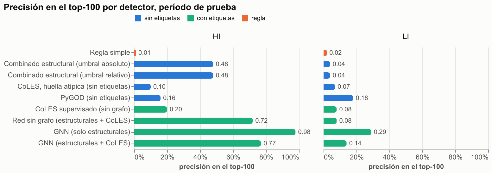

# Hito 4: redes sobre grafos y anomalías con PyGOD

[← Volver a la portada](index.md) ·
[Detalle en el informe técnico](https://github.com/stous1/aml-graph-detection/blob/main/INFORME_TECNICO.md#hito-4-redes-sobre-grafos-fase-supervisada-y-anomalías-con-pygod)

> El período de prueba (días 7 a 10) es el mismo de los hitos 1 a 3. Se midió una sola vez,
> con modelos congelados. La prueba definitiva será Medium, que nadie ha mirado.

## En corto

- **Una GNN entrenada con las etiquetas de desarrollo, solo con variables estructurales**
  (volumen, grado, dinero de paso, velocidad, contrapartes nuevas, montos), es el mejor
  detector del proyecto: en HI, **98 de las 100 primeras alertas** son cuentas ilícitas y el F1
  es 0,276. En LI, top-100 de 0,29 y F1 0,045. Es el **modelo final** que irá a Medium.
- **Las etiquetas valen mucho:** con las mismas señales, el combinado no supervisado logra la
  mitad del F1 y la mitad del top-100 en HI.
- **CoLES empeora la GNN** (F1 0,158 contra 0,276 en HI), igual que en la validación de
  desarrollo. Los embeddings no se trasladan bien de desarrollo a prueba.
- **PyGOD, sin etiquetas, está cerca del azar** en estos datos.
- **¿Aporta el grafo?** Con exactamente las mismas variables, una red sin paso de mensajes
  rinde lo mismo en prueba (AP 0,215 contra 0,210 en HI). En desarrollo el grafo parecía
  ayudar en HI (+0,080 de AP), pero no se repitió. **El mérito es sobre todo de las
  variables** (dinero de paso, velocidad, contrapartes nuevas, grado, montos).
- **Umbrales relativos:** se marca en prueba la misma fracción de alertas que dio el mejor F1
  en desarrollo, sin calibrar valores absolutos de rareza.
- Entrenado en la RTX 4080 SUPER (unos 30 segundos por red); evaluado en CPU con los pesos
  congelados.

| Prueba, HI / LI | Etiquetas | F1 tx | Top-100 | Top-1.000 |
|---|---|---|---|---|
| **GNN, solo estructurales (modelo final)** | sí | **0,276** / **0,045** | **0,98** / **0,29** | **0,40** / **0,10** |
| GNN, estructurales + CoLES | sí | 0,158 / 0,034 | 0,77 / 0,14 | 0,26 / 0,06 |
| Red sin grafo (estructurales + CoLES) | sí | 0,167 / 0,012 | 0,72 / 0,08 | 0,26 / 0,04 |
| Combinado estructural (hito 2) | no | 0,118 / 0,028 | 0,48 / 0,04 | 0,18 / 0,06 |
| PyGOD (CoLA) | no | 0,003 / 0,003 | 0,16 / 0,18 | 0,04 / 0,03 |
| Regla simple | no | 0,003 / 0,003 | 0,01 / 0,02 | 0,02 / 0,02 |

## Archivos

[metricas.json](resultados/hito4/metricas.json) ·
[parametros.json (congelado)](resultados/hito4/parametros.json) ·
[desarrollo.json](resultados/hito4/desarrollo.json) ·
[top-100 interactivo](resultados/hito4/hito4_top100.html) ·
[F1 interactivo](resultados/hito4/hito4_f1.html)
