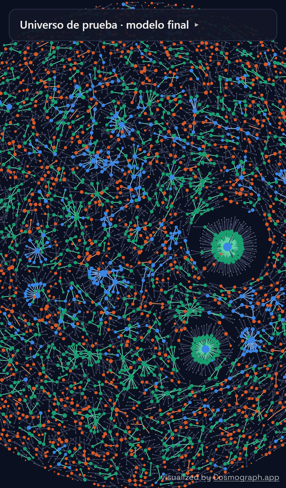

# Hito 5: universo de prueba en Cosmograph

[← Volver a la portada](index.md) · **[Abrir el universo →](hito5_universo.html)**

## Qué estoy viendo

Las cuentas y transferencias del período de prueba (días 7 a 10) que importan para juzgar el
modelo final (la GNN con variables estructurales, congelada en el hito 4):

- **Puntos (cuentas):**
  - **azul:** alerta acertada (el modelo la marcó y tiene lavado);
  - **naranja:** falsa alarma;
  - **aguamarina:** lavado que el modelo no marcó;
  - **gris:** algunas contrapartes de contexto.
- **Enlaces (transferencias):** lavado de un patrón que el modelo detectó, lavado no
  detectado, alertas sobre transferencias legítimas y contexto.
- **Filtro por tipo de patrón:** resalta las cuentas de ese tipo y atenúa el resto. La tabla
  del panel dice cuántos intentos de cada tipo detectó el modelo.

El modelo marca la misma fracción de alertas que dio el mejor F1 en desarrollo (umbral
relativo): 0,59 % de las cuentas en HI y 1,64 % en LI. Pasa el cursor sobre un punto para ver la
cuenta y sus patrones.

| Prueba | Alertas acertadas | Falsas alarmas | Lavado no detectado | Contexto |
|---|---|---|---|---|
| HI | 487 | 1.691 | 1.585 | 4.053 |
| LI | 412 | 7.809 | 1.579 | 9.563 |

Lo que salta a la vista:
- En HI, los ciclos y las dispersiones-concentraciones detectadas aparecen como cadenas y
  estrellas azules.
- El lavado sin patrón no detectado son pares sueltos aguamarina: transferencias aisladas
  que ningún detector de forma ve.
- En LI, el umbral relativo marca muchas más cuentas y la mayoría son falsas alarmas.

El recall por tipo de este universo se verifica contra `resultados/hito4/metricas.json` al
generarlo (`scripts/hito5.py`).

## Celular

El panel arranca plegado en pantallas chicas. HI pesa unos 1,4 MB de datos y LI unos 3 MB; la
biblioteca (Cosmograph 2.5.1) se descarga desde esm.sh.
