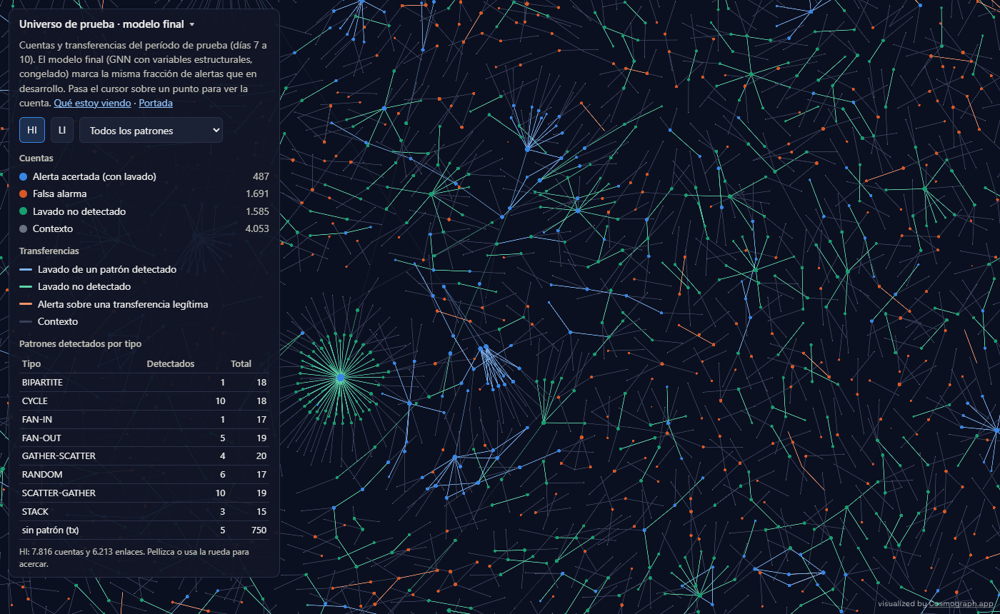

# Detección de lavado en redes de transferencias

**¿Qué cuentas de una red de transferencias están lavando dinero?** Detectores por forma,
huellas de comportamiento y redes sobre grafos sobre AMLworld (IBM, sintético), evaluados con
partición temporal contra la verdad del simulador y siempre comparados con una regla simple.
Caso 2 de un portafolio de ciencia de datos aplicada a banca.

**[Abrir el universo interactivo →](hito5_universo.html)** ·
[Preregistro de la prueba con Medium](preregistro_medium.md) ·
[Código](https://github.com/stous1/aml-graph-detection) ·
[Informe técnico](https://github.com/stous1/aml-graph-detection/blob/main/INFORME_TECNICO.md)

## Modelo final

Una red sobre el grafo de transferencias, entrenada con las etiquetas de desarrollo y solo
con señales que existirían en cualquier banco (tiempo, montos y topología; nada de moneda ni
formato de pago). Período de prueba, días 7 a 10:

| | Etiquetas | F1 tx | Top-100 | Top-1.000 |
|---|---|---|---|---|
| **HI, GNN estructural (modelo final)** | sí | **0,276** | **0,98** | **0,40** |
| HI, combinado estructural | no | 0,118 | 0,48 | 0,18 |
| HI, regla simple | no | 0,003 | 0,01 | 0,02 |
| **LI, GNN estructural (modelo final)** | sí | **0,045** | **0,29** | **0,10** |
| LI, combinado estructural | no | 0,028 | 0,04 | 0,06 |
| LI, regla simple | no | 0,003 | 0,02 | 0,02 |

## En un minuto

- **Hito 5, universo** ([página](hito5.md)): Cosmograph con las alertas del modelo final, los
  patrones por tipo y el lavado no detectado. Carga en celular.
- **Hito 4, grafos** ([página](hito4.md)): la GNN supervisada duplica al combinado no
  supervisado en HI. Pero con las mismas variables una red sin grafo rinde lo mismo: el
  mérito es de las variables. CoLES la empeora y PyGOD queda cerca del azar.
- **Hito 3, CoLES** ([página](hito3.md)): la huella de comportamiento sin etiquetas no aporta
  y "no te pareces a ti mismo" no es viable con 10 días.
- **Hito 2, detectores estructurales** ([página](hito2.md)): la ablación mostró que el
  detector del hito 1 dependía de una huella del simulador (la mezcla de monedas). Ciclos y
  dispersión-concentración con monto conservado sí funcionan sin artefactos.
- **Hito 1, datos y abanicos** ([página](hito1.md)): DuckDB, partición temporal y los
  artefactos del generador (día 1 y cola).

## Lo que hay que saber

- El período de prueba **se usó cuatro veces**, una por hito, siempre con parámetros
  congelados. La prueba que lo resuelve, con HI-Medium y LI-Medium, está
  [preregistrada](preregistro_medium.md) y pendiente.
- Son datos sintéticos de plantilla. LI es mucho más difícil que HI: el 82 % de su lavado son
  transferencias sueltas, sin patrón.

## Hitos

1. [Ingesta, exploración, grafo temporal y abanicos](hito1.md) ✔
2. [Ciclos, dispersión-concentración, variables por cuenta e Isolation Forest](hito2.md) ✔
3. [Huella de comportamiento con CoLES](hito3.md) ✔
4. [PyGOD y redes neuronales sobre grafos](hito4.md) ✔
5. [Visualización con Cosmograph](hito5.md) ✔
